# The Industrial Autonomous Factory & Digital Twin Flight Simulator

> [!IMPORTANT]
> **Executive Thesis**: Anyone can spin up an AWS GPU instance and run a training script. That is a commodity "wrapper app" with zero enterprise defensibility.  
> 
> True institutional-grade infrastructure requires an **End-to-End Industrial Decision Factory under One Roof**: ingesting raw, chaotic client payment ledgers, synthesizing tailored Specialist SDMs (50M–100M params), stress-testing them in a **Digital Twin Flight Simulator that replicates the client's exact production payment plumbing**, autotuning parameters against regulatory limits, and sealing them into in-process host RAM binaries executing in **0.2ms**.

---

## 1. The Industrial Assembly Line vs. The "GPU Wrapper" Fallacy

```
      THE TOY "GPU WRAPPER" (NO MOAT)                 THE INDUSTRIAL DECISION FACTORY (OUR MOAT)
   ┌───────────────────────────────────┐           ┌───────────────────────────────────────────────┐
   │ 1. Upload CSV to Web App          │           │ 1. Raw Material Ingestion & 5-Ledger Fusion   │
   │ 2. Call cloud GPU (model.fit)     │           │    (Auths, Captures, Disputes, Fees, Telemetry)│
   │ 3. Download generic model file    │           │ 2. Pre-Flight Compliance & Survival Hazard    │
   │ 4. Hope it doesn't break in prod  │           │ 3. Ephemeral GPU Foundry ($0.40 Auto-Teardown)│
   └───────────────────────────────────┘           │ 4. Digital Twin Flight Simulator Replay       │
                     ▲                             │    (Replicates client's live payment stack)   │
                     │                             │ 5. Automated Closed-Loop Tuning & Calibration │
       ❌ Fails on 90-day chargeback lag           │ 6. AES-256-GCM Sealing & In-Process SDK (0.2ms│
       ❌ Violates Visa VDMP $25k scheme caps      └───────────────────────────────────────────────┘
       ❌ Blown away by 20ms payment SLA                                   ▲
       ❌ Uncalibrated probability hallucination                          │
                                                     ✅ Full Client Data Sovereignty
                                                     ✅ Counterfactual Proof of ROI (+180 bps)
                                                     ✅ Guaranteed Compliance & In-Host RAM
```

In payment engineering, connecting a GPU to a script is 5% of the problem. The remaining 95% is the **plumbing, survival dynamics, game theory, and hardware physics**.

---

## 2. The 6-Station Industrial Assembly Line (Under One Roof)

```mermaid
flowchart TD
    subgraph Station_1["STATION 1: Raw Material Ingestion & Ledger Fusion"]
        A["Raw Client Data Warehouse<br/>(Snowflake / BigQuery / S3)"] --> B["5-Ledger Reconciliation<br/>(Auth + Settlement + Chargeback + Fees + Telemetry)"]
        B --> C["Pre-Flight Compliance Gate<br/>(PCI-DSS v4.0 Zero-PAN Luhn + PII Stripping)"]
        C --> D["Survival Hazard Adjustment<br/>(90-Day Cohort Maturation)"]
    end

    subgraph Station_2["STATION 2: Specialist Architecture Synthesis"]
        D --> E["Universal Schema Profiler<br/>(Continuous vs Categorical Topology)"]
        E --> F["FT-Transformer Synthesis<br/>(50M-100M Params, 768-Dim, 12 Heads)"]
        F --> G["350,000 BIN Hierarchical Embeddings<br/>(Bayesian Shrinkage Initialization)"]
    end

    subgraph Station_3["STATION 3: Ephemeral GPU Foundry"]
        G --> H["Scale-to-Zero GPU Rental<br/>(RunPod / Lambda / AWS Spot / Apple MPS)"]
        H --> I["Deep Backpropagation<br/>(AdamW + Cosine Anneal + Loss Matrix)"]
        I --> J["Platt Temperature Calibration<br/>(Brier Score Loss Minimization)"]
    end

    subgraph Station_4["STATION 4: Digital Twin Flight Simulator"]
        J --> K["Production Stack Virtualization<br/>(Replicate Acquirers, Rule Engines, Cascade)"]
        K --> L["Counterfactual Replay Simulation<br/>(Replay 100k-1M Historical Transactions)"]
        L --> M["Closed-Loop Autotuning<br/>(Adjust System 2 Governor to 0.70% Scheme Cap)"]
        M --> N["Tamper-Evident SHA-256 Readiness Certificate"]
    end

    subgraph Station_5["STATION 5: Cryptographic Hardening & Packaging"]
        N --> O["ONNX Graph Compilation & SIMD Vectorization"]
        O --> P["AES-256-GCM Envelope Encryption<br/>(Client-Owned PBKDF2 Secret Keys)"]
        P --> Q["Sealed Sovereign Package (.sdmpkg)"]
    end

    subgraph Station_6["STATION 6: Sovereign In-Process Execution"]
        Q --> R["Payment Decision Studio Marketplace<br/>(Private Client Vault)"]
        R --> S["Drop-in Embedded SDK<br/>(Node.js / Python / Go / Java in Host RAM)"]
        S --> T["0.2ms In-Flight Checkout Decision"]
    end

    style Station_1 fill:#f3e5f5,stroke:#7b1fa2;
    style Station_2 fill:#e8eaf6,stroke:#303f9f;
    style Station_3 fill:#e0f2f1,stroke:#00796b;
    style Station_4 fill:#fff3e0,stroke:#e65100;
    style Station_5 fill:#fbe9e7,stroke:#d84315;
    style Station_6 fill:#e8f5e9,stroke:#2e7d32;
```



---

## 3. Deep Dive: The 6 Assembly Stations

### Station 1: Raw Material Ingestion & 5-Ledger Fusion
Enterprises never have clean, unified training tables. Their payment truth is fragmented across five disparate internal silos:
1. **Front-End Telemetry**: Device fingerprints, IP velocity, browser headers.
2. **Gateway Authorization Logs**: ISO 8583 response codes, AVS codes, CVV match flags.
3. **Clearing & Settlement Batch Files**: Which authorizations actually captured money 48 hours later.
4. **Chargeback & Dispute Ledgers**: Reason codes (`10.4 Fraud`, `4837 Fraudulent Transaction`) arriving 60–120 days post-sale.
5. **Acquiring Fee Schedules**: True interchange and scheme markup basis points.

**The Factory Action**:
- Ingests raw data via [`UniversalDataProfiler`](file:///Users/piyushdua/payment_decision_factory/universal_client_pipeline.py).
- Passes records through [`ComplianceGuard`](file:///Users/piyushdua/payment_decision_factory/core/compliance_guard.py), executing ISO/IEC 7812 Luhn checksum scans to guarantee **Zero-PAN PCI liability**.
- Applies **Right-Censored Survival Maturation**: splits transactions into vintage cohorts so un-matured transactions do not poison training labels.

---

### Station 2: Specialist Architecture Synthesis (Not One-Size-Fits-All)
The factory inspects the merchant's payment archetype and dynamically synthesizes the **Specialist SDM (50M–100M parameter Domain Tabular Transformer)**:
- **Feature Tokenizer**: Projects numerical floats (`amount`, `velocity`) into 768-dimensional token space.
- **Hierarchical Bayesian Embeddings**: Initializes representations for the client's observed BINs, inheriting statistical priors from the parent issuer bank and country scheme.
- **Dedicated Loss Formulation**: Configures the exact optimization loss required for the merchant's declared intent (Smart Routing margin maximization, PSD2 3DS exemption ceiling, or Soft Decline recovery).

---

### Station 3: Ephemeral GPU Foundry (Scale-to-Zero Economics)
- **Zero Cloud Idle Cost**: Connects via [`EphemeralGpuProvisioner`](file:///Users/piyushdua/payment_decision_factory/universal_client_pipeline.py) to on-demand spot GPU compute (RunPod RTX 4090 @ $0.44/hr, Lambda A10G @ $0.60/hr, AWS Spot @ $0.38/hr, or local Apple Silicon MPS @ $0.00).
- Runs full PyTorch backpropagation with AdamW and Cosine Annealing.
- Executes **Platt Temperature Scaling**: fits temperature parameter $T$ on held-out validation data to calibrate output logits against Brier score loss.
- **Automated Termination**: Tears down GPU instances immediately upon completion. Total compute COGS: **$0.12 to $0.85 per run**.

---

### Station 4: The Digital Twin Flight Simulator (The Critical Moat)

This is what elevates the platform above any toy wrapper: **the model is never shipped until it passes flight simulation.**

```
                           DIGITAL TWIN FLIGHT SIMULATION
                           
    [ Historical Payment Telemetry ]
                  │
                  ▼
    ┌───────────────────────────────────────────────┐
    │ DIGITAL TWIN FLIGHT SIMULATOR                 │
    │                                               │
    │ 1. Virtualizes Client's Real Production Stack:│
    │    • Acquiring MIDs (Chase, Adyen, Barclays)  │
    │    • Existing Rule Engines (Accertify/Sift)   │
    │    • Gateway Fallback Cascades & Timeouts     │
    │                                               │
    │ 2. Counterfactual Replay Engine:              │
    │    • "What if SDM ran on Black Friday?"       │
    │    • Replays 500,000 real historical orders   │
    │    • Tests soft decline retry trajectories    │
    │                                               │
    │ 3. Automated Closed-Loop Parameter Tuning:    │
    │    • Checks Visa VDMP threshold (0.90% cap)   │
    │    • Clamps System 2 Governor at 0.70%        │
    │    • Tunes 3DS TRA exemption thresholds       │
    └───────────────────────┬───────────────────────┘
                            │
                            ▼
    ┌───────────────────────────────────────────────┐
    │ SHA-256 TAMPER-EVIDENT READINESS CERTIFICATE  │
    │ • Measured Authorization Lift : +214 bps      │
    │ • False Decline Reduction     : $1,420,000    │
    │ • Interchange Cost Savings    : $210,000      │
    │ • P99 Execution Latency       : 0.28 ms       │
    │ • Regulatory Compliance Margin: +20 bps safety│
    └───────────────────────────────────────────────┘
```

1. **Replicating the Client's Production Plumbing**:
   The simulator configures a software replica of the client's live payment stack: their specific PSP fallback order, acquiring contract fee schedules, and legacy rule thresholds.
2. **Counterfactual Replay Simulation**:
   Replays 100,000 to 1,000,000 historical transactions through both the legacy system and the new Specialist SDM simultaneously.
3. **Automated Closed-Loop Parameter Tuning**:
   If the flight simulator detects that an aggressive routing threshold would have approached within 15 bps of the **Visa Dispute Monitoring Program (VDMP) 0.90% threshold**, the **System 2 Statutory Hard Governor** automatically clamps the threshold down, ensuring a 20 bps safety cushion before deployment.
4. **Readiness Certificate**:
   Produces a tamper-evident audit receipt signed with SHA-256 (`artifacts/tenants/{tenant_id}/readiness_certificate.json`). The merchant’s VP of Payments can inspect the empirical ROI before approving rollout.

---

### Station 5: Cryptographic Hardening & Packaging
- The certified model is compiled to a standalone ONNX graph with SIMD optimizations (AVX-512 / Apple Silicon NEON).
- Encrypted via **AES-256-GCM** using client-owned PBKDF2 keys into an immutable `.sdmpkg` binary.
- Model weights never exist in plain-text on disk, in cloud object storage, or in public registries.

---

### Station 6: Sovereign In-Process Execution (Under One Roof)
- The finished product appears instantly in the merchant’s **Payment Decision Studio Private Marketplace**.
- Delivered via native polyglot SDKs:
  - **Python**: `payment_decision_sdk.sealed.SealedPackageClient`
  - **Node.js / TypeScript**: `@payment-decision-factory/sdk`
  - **Go & Java**: C-ABI dynamic linking.
- **0.2ms In-Process RAM Execution**: Evaluates directly in the merchant's API servers. Zero network hops. Zero external dependencies. Zero 25 bps cloud tollbooth.

---

## 4. Why This Architecture Cannot Be Replicated by a "Wrapper App"

| Capability | Generic Cloud "GPU Wrapper" | Our Industrial Autonomous Factory |
| :--- | :--- | :--- |
| **Data Ingestion** | Requires user to upload pre-cleaned, pre-labeled CSV | **5-ledger fusion engine**: joins auts, captures, disputes, fees, and telemetry from Snowflake/BigQuery |
| **PCI Liability** | Leaves merchant vulnerable to PCI-DSS Level 1 scope | **Pre-flight ComplianceGuard**: Luhn ISO 7812 zero-PAN gate blocks unencrypted card numbers |
| **Survival Dynamics** | Oblivious to 90-day chargeback lag (trains on poisoned labels) | **Right-censored vintage survival analysis**: auto-calibrates maturation hazard curves |
| **Model Architecture** | Generic XGBoost or fine-tuned LLM | **Synthesized 50M–100M FT-Transformer**: 768-dim embeddings for 350k sparse BINs |
| **Validation** | Naive random 80/20 train/test split | **Digital Twin Flight Simulator**: counterfactual replay through replica of client's live payment stack |
| **Regulatory Guard** | Pure probabilistic score (can blow past Visa 0.90% cap) | **Dual System 1 + System 2 Governor**: hard statutory enforcement of PSD2 & scheme caps |
| **Runtime Latency** | 50ms–200ms cloud HTTP call (violates 20ms payment SLA) | **0.2ms host RAM execution**: compiled C++ ONNX binary with AES-256-GCM decryption |
| **Compute Economics** | High idle cloud GPU bills | **Ephemeral scale-to-zero compute**: $0.12–$0.85 per run (or $0.00 on local Mac Apple Silicon) |
