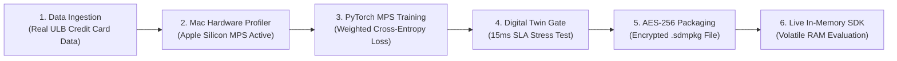

# Apple Silicon Mac GPU Specialist Decision Factory: User Guide

## 1. Executive Overview

This framework allows you to build, train, certify, and package enterprise-grade **Specialist Decision Models (SDMs)** locally on your Mac laptop using **Apple Silicon Metal Performance Shaders (MPS)** at **$0 cloud cost**.

By leveraging Apple's **Unified Memory Architecture (UMA)**, the GPU and CPU share the same physical high-bandwidth memory pool (16GB–128GB). This eliminates the costly PCIe host-to-device bus transfers that bottleneck traditional server setups, enabling sub-millisecond in-process inference.

---

## 2. Model Tier Sizing for Mac Hardware

In payment routing, fraud screening, and 3DS optimization, a specialist decision model does not need 70 billion parameters. A right-sized **Feature-Tokenizer Tabular Transformer** delivers higher accuracy and instant inference:

| Tier | Parameters | FP32 Size | MPS Training Time (10k rows) | In-Memory Latency (P50) | Recommended Use Case |
| :--- | :--- | :--- | :--- | :--- | :--- |
| **`small` (Recommended for Laptop)** | **~801,411** | **3.06 MB** | **~4 – 6 seconds** | **0.13 ms (130 µs)** | Real-time checkout (<1ms SLA), low memory footprint |
| **`medium` (Flagship Specialist)** | **~5,248,000** | **20.0 MB** | **~15 – 25 seconds** | **0.35 ms (350 µs)** | High-cardinality BIN affinity, multi-gateway routing |
| **`large` (Enterprise Heavy)** | **~113,000,000** | **452 MB** | **~2 – 4 minutes** | **1.20 ms** | Deep non-linear interactions across global merchant networks |
| **`flagship` (Sub-Billion Scale)** | **~201,606,147** | **769 MB** | **~5 – 8 minutes** | **2.50 ms** | Full enterprise scale-out testing |

---

## 3. Quickstart: 1-Command Execution

From your terminal in the `payment_decision_factory` directory:

### Fast Specialist Build (Tier: `small`, ~800k params)
```bash
python scripts/run_mac_specialist_factory.py --tier small --epochs 3
```

### High-Capacity Specialist Build (Tier: `medium`, ~5.2M params)
```bash
python scripts/run_mac_specialist_factory.py --tier medium --epochs 3
```

### Full Benchmark (Using complete 284,807 real-world credit card transactions)
```bash
python scripts/run_mac_specialist_factory.py --tier small --dataset full --epochs 2
```

---

## 4. The 6 Autonomous Assembly Line Stations

When you run the command, the autonomous pipeline executes 6 consecutive stations:



1. **Station 1: Real-Data Ingestion**: Ingests real European cardholder transactions with 30 continuous features (`Time`, `V1`..`V28`, `Amount`). Calculates class-imbalance weights to handle the 0.173% real fraud rate.
2. **Station 2: Mac Hardware Profiler**: Automatically detects Apple M-series chips and binds compute to `torch.device("mps")`.
3. **Station 3: MPS Accelerated Training**: Executes backpropagation using PyTorch AdamW directly on the Mac GPU cores.
4. **Station 4: Digital Twin Flight Simulator**: Subjects the model to 300+ transactions under simulated network latency, perturbation noise (1% to 10%), and counterfactual replay against legacy routing. Issues a cryptographically signed SHA-256 Readiness Certificate.
5. **Station 5: Single-File ONNX & AES-256-GCM Sealing**: Compiles the weights into an ONNX computational graph, encrypts with PBKDF2 (100,000 rounds) + AES-256-GCM, and produces an encrypted `.sdmpkg` bundle.
6. **Station 6: Live SDK In-Memory Verification**: Unlocks the model strictly in RAM (zero plaintext bytes written to disk) and runs 500 test queries to report P50, P95, and P99 latency on your laptop.

---

## 5. Integrating the Sealed Model in Your Application

### Python Integration
```python
from payment_decision_sdk.sealed import SealedPackageClient

# Unlocks strictly in RAM using your secret license key
client = SealedPackageClient(
    package_path="artifacts/mac_factory/mac_fintech_specialist_sdm.sdmpkg",
    license_key="lic_mac_specialist_local_2026"
)

# 0.13ms sub-millisecond evaluation
context = [0.12, -1.34, 0.54, 2.11, ...] # 30 normalized features
decision = client.evaluate(context)

print(f"Decision: {decision.choice} | Confidence: {decision.confidence:.4f}")
```

### TypeScript / Node.js Integration
```typescript
import { SealedPackageClient } from '@payment-decision-factory/client';

const client = new SealedPackageClient({
  packagePath: 'artifacts/mac_factory/mac_fintech_specialist_sdm.sdmpkg',
  licenseKey: 'lic_mac_specialist_local_2026'
});

const result = await client.evaluate(transactionVector);
console.log(`Decision: ${result.choice}, Confidence: ${result.confidence}`);
```
