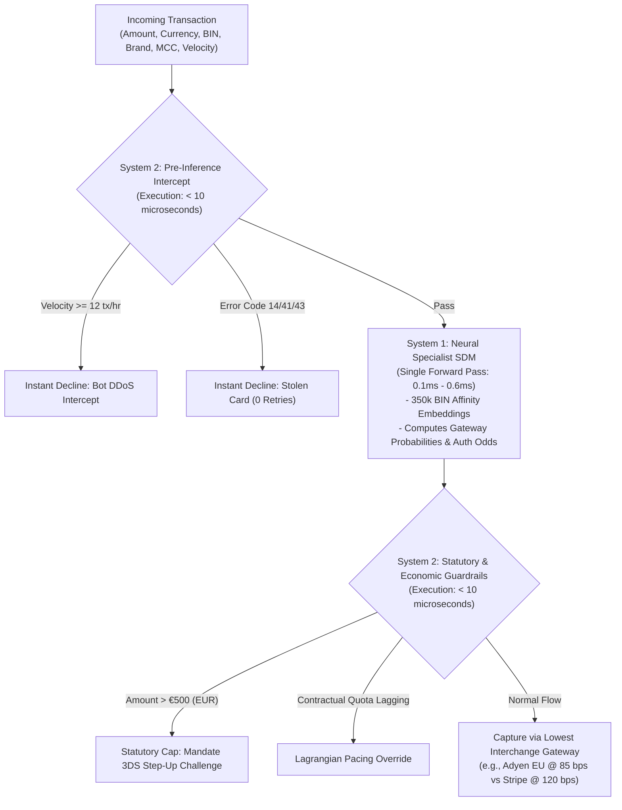

# Payment Decision Studio & Personalized Marketplace: Complete Guide

## 1. Executive Summary

**Payment Decision Studio** delivers an intuitive, modern, Cursor-like developer experience for building, inspecting, testing, and deploying **Specialist Decision Models (SDMs)** on top of a **Hybrid System 1 + System 2 Architecture**.

Instead of interacting with opaque command-line scripts or clunky notebooks, clients receive an interactive, visual cockpit running locally on their server or Mac:
* **Real-Data Ingestion & Training Cockpit**: Launch real-time PyTorch AdamW training on Apple Silicon MPS or cloud GPUs with live loss curves and Brier calibration scores.
* **Cursor-Style Interactive Playground**: Test transactions in real time, inspecting how **System 1 Neural Intuition** and **System 2 Statutory Guardrails** interact.
* **Personalized Model Marketplace**: Private on-premise catalog of all trained, cryptographically certified `.sdmpkg` models.
* **Cryptographic Key Vault & Integration Pathways**: Issue, rotate, and manage client license keys, and copy drop-in integration code for Python, TypeScript, and payment gateway routing middleware.

---

## 2. The Hybrid Architecture in Action



### Why Both Are Essential:
* **System 1 (Neural SDM)**: Discovers non-linear, high-dimensional patterns that rule engines cannot express (e.g., French Visa debit card processed at 2:00 AM has a 94.2% auth rate on Adyen vs 72.1% on Stripe, saving 35 basis points in interchange fees).
* **System 2 (Statutory Guardrails)**: Enforces hard compliance and regulatory rules with **absolute veto power** in <10 microseconds (e.g., PSD2 RTS Article 18.2 forces 3DS on amounts >€500 regardless of neural confidence, avoiding legal non-compliance and payment scheme penalties).

---

## 3. Quickstart: 1-Command Studio Launch

From your terminal in the `payment_decision_factory` directory:

```bash
python scripts/run_studio.py --port 8000 --open
```

Open your browser to: **`http://127.0.0.1:8000`**

---

## 4. Studio Features & Workspaces

### 1. Cursor Playground (Interactive Test Flight)
* **Preset Buttons**: Click pre-configured scenarios ("French Debit €120", "PSD2 High-Value €750", "DDoS Spike 15 tx/hr", "US Prime $240") to test immediate behavior.
* **Side-by-Side Telemetry HUD**:
  * **System 1 Bar Chart**: Visualizes probability distribution across gateways (Adyen EU, Stripe US, Checkout.com) and neural execution time (in microseconds).
  * **System 2 Status Checklist**: Real-time audit checklist displaying whether PSD2 RTS Art 18.2, Bot Velocity, or Cat 1 Stolen Card rules passed or vetoed.
  * **Economics Bar**: Shows estimated interchange fee in basis points, net arbitrage savings, and projected annual lift.

### 2. Autonomous Model Training Cockpit
* **Tier Selection**: Choose between `small` (~801k params, 3 MB), `medium` (~5.2M params, 20 MB), or `flagship` (~201M params).
* **Live Telemetry Stream**: Watch loss curves, epoch progress, and Brier calibration scores streamed directly from Apple Silicon Metal Performance Shaders (MPS).

### 3. Personalized Model Marketplace
* Displays every model trained on the client's infrastructure.
* Shows model size, parameter count, P50/P99 latency, Brier calibration, and cryptographically verified SHA-256 audit hashes.
* Single-click copy of the `.sdmpkg` binary path.

### 4. Cryptographic Key Vault & Integration Pathways
* **Key Lifecycle Management**: Generate and revoke cryptographically random PBKDF2/AES-256 client license keys.
* **Drop-In Integration Code**:
  * **Python SDK**: In-memory volatile RAM decryption via `payment_decision_sdk.sealed.SealedPackageClient`.
  * **TypeScript / Node.js SDK**: Zero-dropout high-throughput evaluation (10k+ TPS).
  * **Gateway Pathway Middleware**: Drop-in routing middleware for Stripe, Adyen, and Checkout.com.
